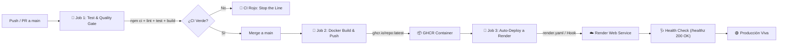

# 📘 Engineering Playbook • Superhero Hub
## Trunk-Based Development, CI/CD Robusto y Despliegue Continuo en Render

> **Versión**: 2.0.0 (Fase 1 Completada)  
> **Equipo**: Diplomado en Ingeniería de Software & DevOps  
> **Repositorio**: [Dastan-27/Practica_Sabado](https://github.com/Dastan-27/Practica_Sabado)  
> **Entorno de Producción**: Render Web Service (Auto-deploy desde `main`)  
> **Gestor de Feature Toggles**: ConfigCat SDK  

---

## 🎯 1. Filosofía de Ingeniería: Trunk-Based Development (TBD)

En este proyecto aplicamos **Trunk-Based Development**, una práctica clave del movimiento DevOps y la Entrega Continua de alto rendimiento:

1. **`main` es la única fuente de verdad**: Todo cambio se integra a `main` de manera frecuente mediante Pull Requests pequeños y de vida corta (< 24-48 horas).
2. **Desacoplamiento entre Despliegue (Deploy) y Lanzamiento (Release)**:
   - **Deploy**: El código se compila, empaqueta en Docker y se despliega automáticamente en Render en cada merge a `main`.
   - **Release**: La funcionalidad se expone a los usuarios mediante **Feature Flags de ConfigCat**, sin requerir nuevos despliegues ni aprobaciones de infraestructura.
3. **Principio "Stop the Line" (Andon Cord)**:
   > 🛑 *"Si el CI está rojo, nadie continúa con nuevas features hasta que el pipeline vuelva a estar verde."*

---

## 📋 2. Definition of Done (DoD) Definitivo

Para que una historia de usuario o incremento de código se considere **DONE (Terminado)**, debe cumplir estrictamente las tres dimensiones:

```
┌────────────────────────────────────────────────────────────────────────┐
│                   DEFINITION OF DONE (DoD) 360°                        │
├───────────────────┬───────────────────────┬────────────────────────────┤
│   🛠️ TÉCNICO       │   🚀 DESPLIEGUE       │   💼 NEGOCIO Y PRODUCTO    │
├───────────────────┼───────────────────────┼────────────────────────────┤
│ • Linter sin fallos│ • CI 100% verde en GH │ • Criterios de aceptación  │
│ • Tests unitarios │ • Imagen en GHCR      │ • Feature Toggle configurado│
│ • Vite build OK   │ • Auto-deploy Render  │ • Sin regresiones visuales │
│ • Fail-fast activo│ • Healthcheck 200 OK  │ • Documentación y Playbook │
└───────────────────┴───────────────────────┴────────────────────────────┘
```

### A. Dimensión Técnica (Código y Calidad)
- [x] **Análisis Estático y Linter**: `npm run lint` pasa con 0 errores de sintaxis y buenas prácticas.
- [x] **Pruebas Automatizadas Unitarias**: `npm test` ejecuta el 100% de los tests con éxito y cuenta con **fail-fast estricto** (`process.exit(1)` ante cualquier fallo).
- [x] **Compilación de Producción**: `npm run build` genera los bundles optimizados en `dist/` sin advertencias críticas.
- [x] **Contenerización Docker**: `Dockerfile` multi-stage verificado con compilador Vite y runtime de Node en usuario no-root.

### B. Dimensión de Despliegue (Infraestructura y Telemetría)
- [x] **Pipeline de CI/CD**: Workflow `.github/workflows/ci.yml` ejecutado y aprobado en GitHub Actions.
- [x] **Registro de Contenedores**: Imagen construida y publicada en **GitHub Container Registry (GHCR)** con tags `:latest` y `:${{ github.sha }}`.
- [x] **Auto-Deploy Continuo a Render**: Sincronización automática de `main` con el servicio en Render configurado vía `render.yaml`.
- [x] **Health Check Endpoint**: El endpoint `/healthz` responde con código `HTTP 200 OK` y estado `healthy`.
- [x] **Procedimiento de Rollback Validado**: Capacidad probada de realizar rollback en Render con 1 clic al commit anterior en caso de anomalías.

### C. Dimensión de Negocio y Producto (Valor y Seguridad)
- [x] **Criterios de Aceptación**: La funcionalidad cumple la necesidad del usuario sin degradar la experiencia previa.
- [x] **Protección por Feature Toggle**: Si la funcionalidad está incompleta, en pruebas canary o experimental, se integra detrás de un flag de **ConfigCat** (`superhero_battle_arena` en estado `OFF` por defecto).
- [x] **Gobernanza de Activación**: Aprobación del Product Owner (PO) para activar toggles a usuarios finales.
- [x] **Documentación Actualizada**: Cambios documentados en `README.md` y `PLAYBOOK.md`.

---

## 🏗️ 3. Arquitectura del Pipeline CI/CD

El pipeline actual opera con 3 etapas orquestadas en GitHub Actions:



---

## 🚦 4. Mapa del Pipeline: Estado y Semáforo de Madurez

| Componente del Pipeline | Estado | Descripción Técnica |
| :--- | :---: | :--- |
| **Trigger Push & PR a `main`** | 🟢 **Ya funciona** | Activación automática en GitHub Actions para ramas y PRs. |
| **Quality Gate (Linter + Tests)** | 🟢 **Ya funciona** | `npm run lint` y `npm test` con fail-fast estricto y 30 tests. |
| **Build de Producción Vite** | 🟢 **Ya funciona** | Empaquetado de assets y generación de mapas en `dist/`. |
| **Imagen Docker en GHCR** | 🟢 **Ya funciona** | Build multi-stage publicado en `ghcr.io` con autenticación token. |
| **Auto-Deploy a Render** | 🟢 **Ya funciona** | Integración nativa con Render vía Blueprint `render.yaml` y webhook. |
| **Health Check Endpoint** | 🟢 **Ya funciona** | Endpoint `/healthz` en `server.js` monitoreando uptime y assets. |
| **Feature Toggle con ConfigCat** | 🟢 **Ya funciona** | SDK `@configcat/sdk` protegiendo la funcionalidad Arena de Batalla. |
| **Rollback de 1 Clic** | 🟢 **Ya funciona** | Reversión instantánea probada en la consola de Render. |
| **DoD Formalizado** | 🟢 **Ya funciona** | 3 dimensiones acordadas y documentadas en este Playbook. |

---

## 🐱 5. Guía de Gobernanza de Feature Flags (ConfigCat)

### Matriz de Roles y Permisos

| Rol | Crear Toggle | Modificar en Local / Sandbox | Activar en Producción (ON/OFF) | Eliminar Toggle (Cleanup) |
| :--- | :---: | :---: | :---: | :---: |
| **Desarrollador** | ✅ | ✅ | 🚫 Solo en Staging | 🚫 Requiere PR |
| **Tech Lead / Arquitecto** | ✅ | ✅ | ✅ Autorizado | ✅ Responsable |
| **Product Owner (PO)** | 🚫 | 🚫 | ✅ **Autoridad de Lanzamiento** | 🚫 |

### Ciclo de Vida del Feature Toggle (Deuda Técnica Cero)

1. **Creación**: Se crea el toggle en ConfigCat (ej. `superhero_battle_arena`) con valor `OFF`.
2. **Implementación**: El código nuevo se escribe detrás de `if (configCatService.isBattleArenaEnabled())`.
3. **Merge & Deploy**: Se mergea a `main` y se despliega a Render. El usuario no ve nada nuevo aún.
4. **Verificación**: El equipo prueba en Staging o activa el toggle en Sandbox/Canary.
5. **Lanzamiento (GA)**: El PO cambia el toggle a `ON` en el dashboard de ConfigCat. La funcionalidad aparece instantáneamente en producción.
6. **Retiro (Debt Cleanup)**: Tras 1-2 sprints con la funcionalidad estable en producción, se crea un ticket técnico para retirar el `if` del código y borrar el flag de ConfigCat.

---

## ☁️ 6. Políticas de Despliegue en Render y Rollback

### Respuestas a Decisiones del Equipo:

1. **¿Desplegamos automáticamente a producción o primero a staging?**
   - **Acuerdo del Equipo**: En Trunk-Based Development con Feature Flags activos, **se despliega automáticamente a producción** desde `main`. Al estar todo código riesgoso o incompleto protegido por ConfigCat (`toggle: OFF`), el despliegue es 100% seguro y se eliminan los cuellos de botella de múltiples entornos intermedios.
2. **¿Qué pasa si el deploy falla?**
   - **Política de Alertas**: Render y GitHub envían notificación inmediata al canal del equipo (Discord/Slack/Email).
   - **Rollback Inmediato**: Si el servicio en Render no levanta o falla el `/healthz`, Render mantiene activa la versión anterior (Zero Downtime Deployment) o el operador presiona **"Rollback to previous deploy"** en el panel de Render.
   - **Regla de Oro**: Se revierte inmediatamente al commit anterior o se apaga el toggle de ConfigCat correspondiente.

---

## ✅ 7. Checklist de Fase 1 (100% Completado)

- [x] **Trunk-Based Development adoptado**: Rama `main` protegida como línea base única.
- [x] **Branch Protection / Ruleset activo**: Prohibido el push directo sin PR y checks aprobados.
- [x] **Pipeline de CI/CD automatizado**: Archivo `.github/workflows/ci.yml` configurado y validado.
- [x] **Suite de pruebas con Fail-Fast**: `scripts/verify-tickets.js` con 30 tests y código de salida estricto.
- [x] **Contenerización y GHCR**: `Dockerfile` multi-stage y publicación automática en `ghcr.io`.
- [x] **Auto-Deploy continuo en Render**: Archivo `render.yaml` y endpoint `/healthz` implementados.
- [x] **Feature Flags con ConfigCat**: SDK integrado y feature sliceada (Arena de Batalla) conmutando en vivo.
- [x] **Definition of Done (DoD) formalizado**: Documentado en el Playbook y acordado por el equipo.

---
*Superhero Hub Engineering Team • 2026*
